# HOI4 Thread & Affinity Optimizer (钢铁雄心 IV 线程与核心亲和度优化器)

[](LICENSE)
[]()
[]()
[]()

基于 **REA（Reverse Engineer Anything）** 逆向工程分析实现的《钢铁雄心 IV》（Hearts of Iron IV）多核调度与线程池优化模块。

专为现代 **Intel 混合大小核（P-Core / E-Core，12~15代 / Arrow Lake）** 以及 **AMD 3D V-Cache 双 CCD 处理器** 设计。通过运行时内存挂钩（Hooking）与 Proxy DLL 代理技术，**彻底解决原版游戏将工作线程死锁在小核/非缓存核心上导致的“掉队者顿挫”与高线程并发拥堵问题**。

> [!IMPORTANT]
> **零文件破坏保证（Zero Disk Mutation）**：本工具采用非侵入式 `version.dll` 代理转发技术，运行期间仅在内存中执行挂钩，**完全不修改、不破坏任何原版游戏 `.exe`、DLC 或脚本文件**，随时删除即可 100% 复原，完全兼容 Steam 成就系统与联机校验。

---

## 🔍 逆向背景：为什么 P 社游戏在现代多核 CPU 上依然卡顿？

通过 REA 工具链对 `hoi4.exe`（PE32+ 64-bit，SHA-256: `92dff182576413474aeed757610910ffa93b686a6ad3219bf3147f10fc9b4bb7`）进行静态与符号分析，揭示了以下调度缺陷：

```mermaid
flowchart TD
    subgraph EngineDefect["⚠️ 原版游戏调度缺陷 (Vanilla Clausewitz)"]
        A["1. 探测逻辑核心数 (RVA: 0x2506f60)"] --> B["2. 派生 N-1 个 Worker 线程 (RVA: 0x250a570)"]
        B --> C["3. 硬编码逐核绑定: SetThreadAffinityMask (RVA: 0x2245a3c)\n(1 << core_id，后半部分线程被锁死在小核 E-Core)"]
        C --> D["4. 任务切块分发: PdxParallelFor"]
        D --> E["5. 同步屏障阻断: WaitAndClear()"]
        E --> F["❌ 大核早早算完，被迫长时间空转等待小核！\n(掉队者短板效应 / Straggler Effect)"]
    end

    subgraph OptimizerFix["⚡ 优化器接管逻辑 (HOI4 Optimizer)"]
        G["自适应 CPU 拓扑识别\n(P-Core / E-Core 硬件探测)"] --> H["锁定最佳线程池规模 (如 8 纯大核)\nInline Hook RVA: 0x2506f60"]
        H --> I["拦截 SetThreadAffinityMask (IAT: 0x273e670)\n放权 Windows 11 Thread Director 智能调度"]
        I --> J["大核满载、各 Worker 算力严格对齐"]
        J --> K["✅ WaitAndClear() 几乎零等待，推演极度平滑！"]
    end
```



### 1. 致命的小核硬绑定（Anti-E-Core Stutter）
- **逆向发现**：在 RVA `0x2245a3c` 处，游戏通过位移 `1 << core_index` 逐核调用 `SetThreadAffinityMask`。
- **后果**：在 8 P-Core + 12 E-Core 的 20 核 CPU 上，线程 8~19 会被**死死锁死在小核（E-Core）上**。由于小时/每日结算必须调用 `WaitAndClear()`（`pdx_task_details.cpp` 断言），**所有高频大核跑完后必须停下来等待跑在小核上的那个最慢的 Worker 跑完**，引发剧烈的每小时掉帧与午夜顿挫。

### 2. 线程池规模过载与锁竞争（Over-Subscription）
- **逆向发现**：函数 RVA `0x2506f60` 会读取所有逻辑核心，上限可达 64 线程（RVA `0x2509543`，`cmp r14d, 40h`）。
- **后果**：在 16 核 32 线程甚至更多核心的 CPU 上，游戏会创建多达 30 多个 Worker。而 HOI4 的并行任务粒度较细，过多的线程频繁竞争临界区（`CriticalSectionAndSpinCount`）和 L3 缓存行，导致线程切换爆炸，多核效率严重倒挂。

---

## 🚀 核心功能特性

1. **CPU 拓扑自适应感知（Anti-E-Core Stutter Hook）**
   - 自动检测 Intel 混合架构（P-Core / E-Core）与 AMD 拓扑；
   - 挂钩 IAT `SetThreadAffinityMask`（RVA `0x273e670`），拦截小核死锁，交由 Windows 11 Thread Director 和现代调度器动态分发，消除“掉队者短板”。
2. **线程池黄金规模重塑（Thread Scaler Hook）**
   - Inline Hook 核心探测函数（RVA `0x2506f60`），默认将线程池收敛至 **8 线程黄金配比（1 主线程 + 7 工作线程）**；
   - 100% 独占物理大核，0 线程落入小核，消除跨核锁竞争与内存总线拥堵。
3. **针对重度大型 Mod（如 TFR / KR / MD）特别优化**
   - 大型 Mod 包含庞大的国家割据与经济脚本（如 TFR 北美内战爆发后的几十个军阀）。锁定纯大核能最大化提升单核最高睿频与 L3 缓存命中率，大幅拉升 5 档速推演帧率。
4. **完全透明的 Proxy DLL 代理架构**
   - 完整提供 `version.dll` 的全部 17 个原生 Windows API 导出转发，由 Windows 装载器静态转发至 `C:\Windows\System32\version.dll`，零性能损耗、零崩溃风险。

---

## 📦 快速安装与使用

### 方法一：Proxy DLL 自动加载（推荐，最省心）

1. 从 [Releases](../../releases) 页面下载最新发布的压缩包；
2. 将压缩包内的两个文件复制到《钢铁雄心 IV》的游戏根目录（即 `hoi4.exe` 所在目录）：
   ```text
   C:\Program Files (x86)\Steam\steamapps\common\Hearts of Iron IV\
   ├── hoi4.exe
   ├── version.dll           <-- 复制到此处
   └── hoi4_optimizer.ini    <-- 复制到此处
   ```
3. 按日常方式直接从 **Steam** 或 **Paradox Launcher** 启动游戏即可自动生效！

#### 如何验证优化器已正常工作？
启动游戏后，游戏根目录下会自动生成 `hoi4_optimizer.log`，内容示例如下即表示挂钩成功：
```text
[21:20:04.341] === Hearts of Iron IV REA-Guided Performance Optimizer ===
[21:20:04.341] Host Binary: C:\Program Files (x86)\Steam\steamapps\common\Hearts of Iron IV\hoi4.exe
[21:20:04.341] CPU Topology Detected:
[21:20:04.341]   - Logical Processors : 20
[21:20:04.341]   - Physical Cores     : 20
[21:20:04.341]   - Intel Hybrid Architecture: YES (P-Cores: 8, E-Cores: 12)
[21:20:04.341] [SUCCESS] Hooked SetThreadAffinityMask in IAT (RVA: 0x273e670). Anti-E-Core stutter enabled.
[21:20:04.341] [SUCCESS] Patched Core Count Evaluator (RVA: 0x2506f60) -> Forced 8 Threads (1 Main + 7 Workers).
[21:20:04.341] [INIT COMPLETE] Optimizer is active. Game execution proceeding seamlessly.
[21:21:20.841] [AffinityHook] Intercepted SetThreadAffinityMask (Thread: 0xFFFFFFFFFFFFFFFE, Mask: 0x400) -> BYPASSED.
```

#### 如何卸载？
前往游戏目录，直接删除 `version.dll`、`hoi4_optimizer.ini` 和 `hoi4_optimizer.log`，游戏立刻恢复原状。

---

### 方法二：纯外挂内存补丁器（零文件驻留）

如果希望游戏目录下不产生任何额外文件，可以使用外部 Python 注入脚本：
1. 正常启动游戏；
2. 打开终端运行：
   ```bash
   python tools/hoi4_memory_patcher.py 8
   ```
3. 脚本将通过 Windows 调试 API 实时定位运行中的 `hoi4.exe` 并写入内存补丁，游戏关闭后内存自动释放。

---

## ⚙️ 配置文件说明 (`hoi4_optimizer.ini`)

```ini
[Hoi4Optimizer]
; 1 = 启用优化器, 0 = 禁用所有 Hook
Enabled = 1

; 1 = 拦截并绕过硬编码的单核绑定 (拦截 SetThreadAffinityMask)
; 彻底根除大小核 (P/E-Core) 掉队拖累问题，允许 Windows 调度器动态平衡
BypassAffinityPinning = 1

; 目标工作线程池总数 (1 主线程 + N-1 工作线程):
; 0  = 自动模式 (自适应物理大核数量，通常为 8 线程)
; 6  = 强制 6 线程 (适合 6 核 CPU)
; 8  = 强制 8 线程 (强烈推荐！最适合多数 8 物理大核架构及 TFR 等重型 Mod)
; 12 = 强制 12 线程 (部分大型战役测试)
; -1 = 禁用线程池重塑 (使用游戏默认的全部逻辑核心)
WorkerThreadCount = 0

; 1 = 记录调试日志至 hoi4_optimizer.log, 0 = 关闭日志
EnableLog = 1
```

---

## 🛠️ 自行编译源码 (Build from Source)

环境要求：
- Windows 10/11 x64
- Visual Studio 2022 / 2026（安装 C++ 桌面开发套件）

只需双击运行根目录下的 `build.bat`，即可一键编译生成 `bin/version.dll`：
```cmd
build.bat
```

---

## 📜 许可证 (License)

本项目基于 [MIT License](LICENSE) 开源。仅供计算机逆向工程技术交流与个人性能优化研究使用。
